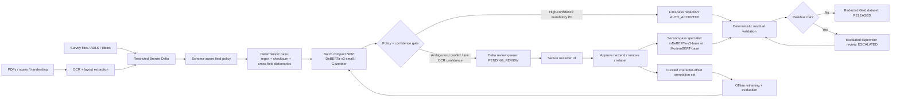

# gov-survey-redact

Hybrid two-pass PII and organisational re-identification redaction pipeline for Australian Government survey data, built for both **local batch execution** (CLI / Python / CSV / NDJSON) and **Azure Databricks** (`pandas_udf` / `mapInPandas` / Delta Change Data Feed / Unity Catalog).

## Architecture Overview

Rather than sending every survey response through a single expensive generative LLM, `gov-survey-redact` implements an **asymmetric two-pass hybrid architecture**:



### Key Capabilities

1. **Schema Pruning First (`gov_survey_redact.schema`)**:
   - Whole columns with known dispositions (`respondent_id`, `household_id`, `respondent_email`, `date_of_birth`) are tokenised, masked, or generalised without invoking NER.
   - Numeric/categorical scales pass through untouched.
   - Open-text responses preserve `[Question: ...]` prompt context without concatenating the entire questionnaire into one blob.
2. **Cross-Field Deterministic Propagation (`gov_survey_redact.propagation`)**:
   - Builds an ephemeral per-record dictionary (`CrossFieldDictionary`) from structured respondent/household fields (`respondent_name`, `household_members`, `street_address`, `employer_name`, `phone`, `email`) and scans all open-text answers in that record before generic NER.
3. **Australian Government & Workplace Deterministic Recognisers (`gov_survey_redact.detectors`)**:
   - **Checksummed & Validated Direct Identifiers**: TFN (ATO mod-11), ABN (ABR mod-89), ACN (ASIC mod-10), Medicare (weighted mod-10), Centrelink CRN, AGS / Employee Reference IDs, workers' compensation claim references (`WC-`/`CLM-`/`INC-` forms and labelled references), BSB, Credit Cards (Visa, Mastercard, Amex, eftpos, UnionPay + Luhn), IBAN (ISO 7064 mod-97), Australian Passports, State Driver Licences, ACMA Phone Numbers, Email (standard + character-spaced), IPv4/IPv6/MAC, Australia Post State/Postcodes, Street Addresses, and Australian day-first/ISO Dates.
   - **OCR-Tolerant Checksum Handling**: When `ocr_confidence` is low or an identifier label precedes an OCR-corrupted candidate (`O↔0`, `I↔1`), checksum failure is treated as **uncertainty rather than safety** — redacting the candidate and routing the record to `PENDING_REVIEW`.
   - **Organisational & Public-Sector Implicating Sequences**: Named employers/agencies, SymSpell 1-edit fuzzy lexicon (`Lexicon`), Modern Award codes (`MA000019`), APS/EL/SES officer classifications, directorates/branches/divisions, government processes (`machinery of government review`, `ministerial submission`, `FOI request`), security clearances (`NV1`, `NV2`, `PV`, `secret`), cohorts, named workplace sites (with 1-edit typo tolerance), and third-party colleague/supervisor naming.
   - **Quasi-Identifier Generalisation (`gov_survey_redact.generalise`)**: Widens exact dates to year (`12/03/1985` -> `1985`), ages to 10-year bands (`45` -> `45-54`), tenure to service bands (`18 years of service` -> `10-19 years of service`), and team sizes to headcount bands (`three` -> `2-5 people`) while leaving substantive protective/hazard prose intact.
4. **Two-Pass Model Routing & Reviewer Hard Constraints (`gov_survey_redact.records`)**:
   - **Pass 1**: Runs deterministic recognisers + compact `DeBERTa-v3-small` (with automatic zero-dependency fallback to `GazetteerBackend` when local transformer weights are absent).
   - **Review State Machine**: `FIRST_PASS` -> `AUTO_ACCEPTED` or `PENDING_REVIEW` -> `REVIEWED` -> `SECOND_PASS` -> `RESIDUAL_QA` -> `RELEASED` (or `ESCALATED`).
   - **Hard Constraints**: Reviewer `APPROVE`, `EXTEND`, and `RELABEL` decisions become immutable hard constraints in Pass 2; `REMOVE` decisions suppress false positives.
   - **Pass 2**: Selects `ModernBERT-base` (up to 8,192 tokens) for long English narratives (>512 words) and `mDeBERTa-v3-base` for multilingual or semantically ambiguous responses, using union-of-spans (`overlap_mode="union"`), followed by deterministic residual validation and k-anonymity cohort disclosure control (`gov_survey_redact.residual`).
5. **OCR Bounding Polygon Geometry & Privacy-Safe Audit Trail (`gov_survey_redact.ocr`, `gov_survey_redact.audit`)**:
   - Maps character-offset findings back to page bounding polygons (`VisualRedactionBox`) for PDF/scan redaction.
   - Emits canonical character-offset `AnnotationRecord` items for offline retraining and privacy-safe `AuditLogEntry` records (storing HMAC-SHA256 span digests, offsets, model/rule/threshold versions, and reviewer principals without ever logging raw PII).

## Quick Start

### Python API

```python
from gov_survey_redact import (
    Category,
    ReviewAction,
    ReviewerDecision,
    Span,
    SurveyRedactor,
    survey_redactor,
)

survey = SurveyRedactor(survey_redactor(salt=b"0" * 32))

# Pass 1 with cross-field propagation from structured columns
first_pass = survey.redact_record(
    "I am one of three EL2s in the Migration directorate. My partner Kiran Halvorsen also works at Northline Services. TFN 123 456 782.",
    record_id="RESP-001",
    field_id="Q3",
    structured_context={
        "respondent_name": "Marisol Halvorsen",
        "household_members": "Marisol Halvorsen; Kiran Halvorsen",
    },
)

print(first_pass.text)
print(first_pass.review_state, first_pass.review_reasons)

# Human review -> Pass 2 (mDeBERTa-v3-base / ModernBERT-base + residual validation)
reviewed, annotation = survey.apply_review_decisions(
    first_pass,
    decisions=[
        ReviewerDecision(
            span=Span(64, 79),
            action=ReviewAction.APPROVE,
            category=Category.NAME,
            reviewer_principal="reviewer@agency.gov.au",
            reason_code="CONFIRMED_HOUSEHOLD_MEMBER",
        )
    ],
)
second_pass = survey.run_second_pass(reviewed, field_id="Q3")
print(second_pass.review_state, second_pass.second_pass_model_used)
```

### CLI & 8-Stratum Synthetic Benchmark

```bash
# Redact free text from stdin or files
gov-survey-redact --survey --format json <<< "I am an APS 6 in the integrity unit, TFN 123 456 782"

# Run the 8-stratum synthetic government survey benchmark and verify acceptance gates
gov-survey-redact --benchmark 400
```

## Test Datasets (`data/`)

All survey-response fixtures are stored as **Qualtrics-shaped records** (a
`qualtrics` instrument definition plus `ResponseId`, the standard metadata
columns, embedded fields, and `QID` question columns). The canonical annotation
file remains a character-offset *training* format — it is not a survey
submission and therefore keeps its own schema.

| Dataset | Contents |
| --- | --- |
| `aps_workplace_census_dirty.json` | 11 APS/State Government census responses (Qualtrics instrument `SV_apsWorkplaceCensus2026`) with typos, transpositions, spaced emails, fullwidth digits, multilingual rows, empty/whitespace fields, duplicate identifiers, all-caps addresses, and protective hard-negative controls |
| `citizen_services_claims_and_ocr.json` | 9 citizen-service, reimbursement, identity-document, and OCR-scan records (`SV_citizenServicesClaims2026`) covering every Australian identifier class, multi-page OCR geometry with confidence-only words, network identifiers, URL credentials, and hard negatives (version strings, currency, invalid check digits, redacted claim references) |
| `canonical_annotations_and_edge_cases.json` | Canonical character-offset annotations, reviewer hard-constraint adjudication, multilingual/low-OCR routing, and long (>512-word) narratives for second-pass model selection |
| `synthetic_stratified_benchmark.json` | 80-record stratified benchmark (`SV_syntheticStratifiedBenchmark`) across all 8 strata with planted secrets, `mandatory` flags, embedded household columns, OCR confidence, and must-survive fragments; replayed through `evaluate_corpus` to assert the acceptance gates |
| `qualtrics_whs_batches/` | Generated by `scripts/qualtrics_batch_check.py`: WHS claims-experience batches in API JSON, wide CSV, and three-line TSV, with ground-truth sidecars, instrument definition, manifest, and effectiveness report |

`pytest` treats these files as executable specifications: every
`must_not_appear` fragment must be gone, every `must_appear` fragment must
survive, expected categories/review states must hold, OCR polygons must map
back to the right pages, and the checked-in benchmark must pass the
procurement acceptance gates.

### Edge-Case Guarantees

* **Never leak on uncertainty** — OCR-corrupted identifiers with failed
  checksums are still masked and routed to review, even if a global
  `min_confidence` floor is raised above their score.
* **Never un-mask during review** — when Pass 1 enabled the OCR-tolerant
  recogniser profile (low OCR confidence), `run_second_pass` reuses the same
  profile, so reviewer approval cannot reintroduce an OCR-corrupted identifier.
* **Never destroy text on stale offsets** — reviewer decision spans, serialised
  findings, and caller-supplied spans are clamped to the text bounds; empty or
  reversed spans are ignored instead of being masked at wrong offsets.
* **Never overlap the output** — union-of-spans resolution is transitive, so a
  short bridging detection can no longer leave two overlapping spans that
  corrupt text when applied; locked human decisions are never absorbed.
* **Never silently drop records** — non-string survey cells are coerced,
  `redact_many` pads missing IDs, and stale OCR layouts are not mapped to the
  wrong character offsets.

## Settings Matrix Comparison

`scripts/run_settings_matrix.py` executes every dataset against a matrix of
pipeline configurations and renders a ranked console report (leaderboard,
full matrix, per-axis sensitivity, recommended settings, sample outputs):

```bash
# quick profile: 24 runs (NLP x overlap x style x second pass)
python3 scripts/run_settings_matrix.py --profile quick

# standard (72 runs) or full (288 runs incl. OCR mode, review threshold)
python3 scripts/run_settings_matrix.py --profile standard
python3 scripts/run_settings_matrix.py --profile full --json /tmp/matrix.json

# custom axes — audience and min_confidence are extra axes
python3 scripts/run_settings_matrix.py --axes nlp,style,audience

# scope the sweep when iterating
python3 scripts/run_settings_matrix.py --datasets aps,canonical --benchmark-limit 20
```

Metrics are graded on the final released text (second pass applied to queued
records when enabled): full-literal leakage, surviving identifier fragments
(catches `style=partial` suffix leaks), over-redaction, expectation failures,
review load, idempotence, and the synthetic acceptance gates. The composite
score weights leakage 60%, fragment traces 10%, over-redaction 20%, and review
load 10%, with hard penalties for failed gates or non-idempotent output.

## WHS Claims-Experience Programme (Qualtrics)

The survey programme runs on **Qualtrics**, so every survey structure in this
repository replicates Qualtrics conventions (`gov_survey_redact.qualtrics`):

* **Wide exports** use the standard metadata block (`StartDate`, `EndDate`,
  `Status`, `IPAddress`, `Progress`, `Duration (in seconds)`, `Finished`,
  `RecordedDate`, `ResponseId`, `RecipientEmail`, `DistributionChannel`,
  `UserLanguage`, …), then embedded-data fields, then one `QID` column per
  question.
* **API JSON** mirrors `GET /API/v3/surveys/{id}/responses` — flat `values`
  keyed by API names, text-entry answers under `QIDn_TEXT`, closed questions
  storing recode values with display text in `labels`.
* **TSV exports** carry the Qualtrics three-line header (question text /
  `{"ImportId": "QIDn"}` / answer reference) and round-trip through the readers.

### Claims-experience instrument

`gov_survey_redact.whs.WHS_CLAIMS_INSTRUMENT` replicates the themes and
published wording of Safe Work Australia's **National Return to Work Survey**
claims-experience module (Collie et al. 2019, *BMC Public Health* 19:927 —
open & honest process, good communication, protecting best interests, treated
fairly, helped with recovery) plus insurer claims items: case-manager respect
and contact frequency, return-to-work plans, suitable duties, employer contact,
payment timeliness and adequacy, recovery confidence, injury type, jurisdiction,
time-to-lodge and employer type — with free-text questions where claimants
naturally mention case managers, employers, worksites, treating practitioners,
claim references and contact details.

### Synthetic batches & effectiveness checks

```bash
# generate + "submit" 6 batches × 40 Qualtrics responses and grade the pipeline
python3 scripts/qualtrics_batch_check.py --formats api,ndjson,csv,tsv

# 10 brand-new waves as Qualtrics NDJSON response exports, replayed and graded
python3 scripts/qualtrics_ndjson_datasets.py

# larger run, custom seed, JSON effectiveness report alongside the files
python3 scripts/qualtrics_batch_check.py --batches 10 --per-batch 60 --seed 7 --json
```

Each batch is written in the requested Qualtrics formats plus a ground-truth
sidecar, read back through the Qualtrics readers (round-trip check), redacted
with cross-field propagation from embedded data, schema-governed embedded
columns (claim numbers tokenised, contact fields labelled, `IPAddress` masked),
reviewed by the second pass when queued, and graded on identifier recall,
character-level recall, response escape rate, over-redaction, review load,
idempotence, and the acceptance gates — per batch and cumulatively.

`scripts/qualtrics_ndjson_datasets.py` produces ten *distinct waves* (baseline,
settled claims, escalated disputes, self-insured employers, multilingual,
abandonment-heavy, contact-opt-in, legacy archive, de-identified pilot, sparse
feedback) as **NDJSON responses exports** — one API-shaped response object per
line — writes matching ground-truth sidecars, and grades every wave individually
and cumulatively. Artefacts land in `data/qualtrics_ndjson/` (`*.ndjson`,
`*.ground_truth.json`, `instrument.json`, `manifest.json`, optional
`effectiveness_report.json`).

The CLI ingests Qualtrics exports directly when `--survey` is used: fixture
files with an embedded `qualtrics` definition, API JSON with a sibling
`instrument.json` (or `--instrument PATH`), wide CSV/three-line TSV exports, and
NDJSON response exports all produce NDJSON redaction summaries with governed
embedded fields.

## Development

```bash
pip install -e '.[dev]'
pytest -v
ruff check .
```

## Further Reading

* **[docs/technical_guide.md](docs/technical_guide.md)** — stage-by-stage technical
  guide to how incoming Qualtrics survey data is processed into release-safe
  output (detectors, confidence routing, overlap resolution, review state
  machine, disclosure control, audit trail, tuning and verification).
* **[examples/azure_databricks_two_pass.md](examples/azure_databricks_two_pass.md)**
  — Bronze → review queue → second pass → Gold deployment on Azure Databricks.
