# Technical Guide — How the Redaction Module Processes Survey Data

This guide explains, stage by stage, how `gov-survey-redact` turns an incoming
Qualtrics survey export (or NDJSON/CSV/TSV equivalent) into a release-safe
dataset, and why each safeguard exists. Every behaviour described here is
implemented in `src/gov_survey_redact/` and verified by the dataset harnesses in
`tests/`.

**Audience:** engineers integrating the module into a survey pipeline, privacy
officers reviewing the design, and reviewers triaging the output.

---

## 1 · Ten-second summary

For each free-text answer and each sensitive embedded column, the module:

1. **Governs whole columns** whose disposition is known (names, emails, claim
   numbers) without invoking language models.
2. **Builds a per-record dictionary** from the same respondent's structured
   data and hunts those literal values in every open-text answer.
3. **Runs deterministic recognisers first** — checksummed Australian and
   financial identifiers, contact details, addresses, employer/agency terms,
   implicating phrases, quasi-identifiers.
4. **Adds token-classification NER** (DeBERTa/mDeBERTa/ModernBERT, or the
   dependency-free gazetteer) only where nothing has been claimed yet.
5. **Resolves overlaps** with longest-span or union-of-spans semantics — human
   reviewer decisions are immovable.
6. **Routes uncertainty to humans** instead of guessing: confidence bands decide
   auto-redact vs. review queue; OCR-corrupted identifiers are *never* treated
   as safe.
7. **Rewrites** with masks, labels, hashes, or generalised bands — idempotent, so
   re-running changes nothing.
8. **Scores re-identification risk**, applies k-anonymity disclosure control,
   and raises the record to `PENDING_REVIEW` / `ESCALATED` when needed.
9. **Emits privacy-safe audit logs** (HMAC span digests, offsets, versions, no
   raw PII) and canonical annotation records for offline retraining.

---

## 2 · Architecture

```mermaid
flowchart LR
    A["Qualtrics export<br/>NDJSON / API JSON / CSV / 3-line TSV"] --> B["Instrument model<br/>QIDs, embedded fields, metadata"]
    B --> C["S0 Column governance<br/>(schema policy)"]
    B --> D["S1 Cross-field propagation<br/>(respondent dictionary)"]
    D --> E["S2 Deterministic recognisers<br/>checksums · contact · org · implication · quasi"]
    E --> F["S3 NLP token classification<br/>DeBERTa / mDeBERTa / ModernBERT / gazetteer"]
    F --> G["S4 Overlap resolution<br/>longest · union · hard constraints"]
    G --> H["S5 Confidence routing<br/>auto-redact · review · discard"]
    H --> I["S6 Rewrite + generalisation<br/>mask · label · hash · token · partial · bands"]
    I --> J["S7 Risk scoring & routing<br/>bands + reasons"]
    J --> K["S8 Disclosure control<br/>residual measure · k-anonymity"]
    J --> L{"Queued?"}
    L -->|yes| M["Human review<br/>APPROVE/EXTEND/REMOVE/RELABEL"]
    M --> N["S9 Second pass<br/>hard constraints · union · residual QA"]
    L -->|no| O["Release candidate"]
    N --> P{"Residual risk?"}
    P -->|no| O
    P -->|yes| Q["ESCALATED to supervisor"]
    O --> R["S10 Audit + annotations"]
```



### Design principles

| Principle | What it means in code |
| --- | --- |
| **Deterministic first** | Regex + checksum recognisers run before any model; the model only sees unclaimed text (`_filter_nlp`). |
| **Uncertainty must never leak** | Failed-checksum OCR candidates are retained for masking *and* forced to review (`checksum="failed_ocr_candidate"`). |
| **Fail-safe on bad input** | Spans are clamped to text bounds; empty spans are dropped; OCR profile is carried into the second pass; nothing silently truncates. |
| **Human decisions are immutable** | Reviewer `APPROVE`/`EXTEND`/`RELABEL` spans become hard constraints that union merging may never absorb or shrink. |
| **Idempotence by construction** | Replacements are recognisable placeholders (`[LABEL]`, `category_ab12cd34`) that are skipped by later runs. |
| **Explainable routing** | Every record carries `review_reasons` and risk `signals`, not just booleans. |

---

## 3 · Input model (Qualtrics)

Survey structures replicate Qualtrics conventions (`gov_survey_redact.qualtrics`):

* **Instrument** (`QualtricsInstrument`): questions keyed by `QIDn` with an
  `export_tag`, question text, type (`TE` text-entry, `MC` single answer,
  `Likert`), and choices; plus **embedded data fields** (claims-system values
  such as `claim_number`, `respondent_name`, `respondent_email`,
  `respondent_phone`, `employer_name`).
* **Responses** (`QualtricsResponse`): flat `values` keyed like the wide export
  — the standard metadata block (`StartDate`, `EndDate`, `Status`, `IPAddress`,
  `Progress`, `Duration (in seconds)`, `Finished`, `RecordedDate`, `ResponseId`,
  `DistributionChannel`, `UserLanguage`, …), embedded fields, then `QIDn`
  answers. Text entry in API JSON is emitted as `QIDn_TEXT`; closed questions
  store recode values with display text in `labels`.
* **Readers/writers**: `read_ndjson` / `read_api_json` / `read_tsv` (with or
  without the three-line `{"ImportId": "QIDn"}` header) and matching writers.
  Every format round-trips losslessly (verified in `tests/test_qualtrics.py`).

### How columns are classified

`redaction_targets(instrument)` splits the export into:

| Class | Examples | Treatment |
| --- | --- | --- |
| **Open text** | `QID21 service_experience`, `QID22 case_manager_experience`, contact block | full hybrid pipeline |
| **Sensitive embedded** | `claim_number`, `respondent_name`, `respondent_email`, `respondent_phone`, `employer_name` | whole-column schema policy **and** cross-field dictionary |
| **Governed metadata** | `IPAddress` (when `redact_metadata_ip=True`) | masked via schema policy; other metadata columns pass through |
| **Closed questions** | Likert items, injury type, jurisdiction | numerically coded; never free text (recode values are not answers) |

Partial responses (abandoned surveys) simply have missing keys; every accessor
tolerates gaps (`text_answers` skips empty values), and metrics grade both
complete and incomplete rows.

---

## 4 · Stage-by-stage processing

### S0 — Column governance (schema pruning)

`SurveySchema.policy_for(column, sample)` resolves a `FieldDisposition` without
running NER:

| Disposition | Behaviour |
| --- | --- |
| `WHOLE_COLUMN_TOKENISE` | stable pseudonym, e.g. claim numbers → `reference_id_4b2918cc` |
| `WHOLE_COLUMN_REDACT` | mask or label (`[EMAIL]`) per style |
| `WHOLE_COLUMN_GENERALISE_DOB` | exact date → year (`14/08/1982` → `1982`) |
| `WHOLE_COLUMN_REMOVE` | column dropped from the output row |
| `PASSTHROUGH_METADATA` / `PASSTHROUGH_NUMERIC` | untouched (unless `redact_metadata_ip`) |
| `FREE_TEXT_HYBRID` | routed to the full pipeline |

### S1 — Cross-field deterministic propagation

`CrossFieldDictionary.from_record(embedded)` builds an ephemeral per-record
dictionary. Multi-word names are also registered as individual tokens
(`Sam Whitlam` → `Sam`, `Whitlam`), shortest values are matched last, and common
words (`team`, `care`, …) are blocked. `KnownRecordDetector` then scans every
open-text answer with word-boundary regexes — so "my partner Kiran Halvorsen"
is caught even before organisation/implication rules run.

### S2 — Deterministic recognisers

Detector families (all in `detectors/`):

| Family | Examples | Validation |
| --- | --- | --- |
| Government IDs | TFN (mod-11), ABN (mod-89), ACN (mod-10), Medicare (weighted mod-10), Centrelink CRN, employee refs, **claim references** (`WC-`/`CLM-`/`INC-`) | checksum + label/shape |
| Financial | Visa/MC/Amex/eftpos/UnionPay (Luhn + IIN), IBAN (mod-97), BSB | checksum |
| Contact | Email (standard + character-spaced), ACMA phone plan (+61, 1300/1800), street addresses, PO boxes, state postcodes | plan rules, AU Post ranges |
| Network | IPv4/IPv6/MAC, URL credentials, API keys | structural |
| Dates | day-first AU, ISO, named months | real calendar bounds |
| Organisation | named entities, government agencies, employment-context orgs, builtin lexicon (regulators, acts, schemes, internal systems) with 1-edit SymSpell tolerance | suffix/gazetteer |
| Implication | uniqueness claims, APS/SES levels, directorates, government processes, clearances, cohorts, named sites (typo tolerant), third-party naming | ~30 curated rules |
| Quasi | job title/grade, tenure, team size, employment status, health detail | cue guards (protective phrasing never triggers) |

**OCR-tolerant checksum handling** — the module's most safety-critical trick.
When a candidate is labelled (`TFN:`) or `ocr_mode` is active (which
`SurveyRedactor` turns on automatically when `ocr_confidence < 0.80`), digits are
repaired (`O→0`, `I/l→1`, `S→5`, `B→8`) and:

* repaired + valid checksum → normal finding at reduced confidence (`0.72`) with
  `ocr_repaired: true`, which *also* queues the record (reason
  `ocr_repaired_identifier`);
* repaired + failed checksum → when the OCR profile is active and the candidate
  carries a nearby identifier label, it is **retained anyway** at `0.58` with
  `checksum: failed_ocr_candidate`, masked, and routed to review (reason
  `ocr_checksum_failure`). Uncertainty is treated as danger, never as safety.

Because identifiers can be ambiguous after repair (a corrupted TFN may
re-validate as an ACN), all checksummed interpretations compete on confidence
and every survivor is masked — the queue records the ambiguity for a human.

### S3 — NLP token classification

`DeBERTa-v3-small` (pass 1), `mDeBERTa-v3-base` / `ModernBERT-base` (pass 2),
`spaCy`, or the `GazetteerBackend` fallback. Chunking preserves character
offsets (`chunk_text_with_overlap`); findings are class-thresholded and only
survive in regions the deterministic stage has not claimed.

### S4 — Overlap resolution

`resolve_overlaps(findings, order, mode)` ranks candidates by
`hard constraint → longest span → deterministic before NLP → confidence →
detector order`, then:

* **longest mode** (pass 1 default): first ranked span wins; others dropped.
* **union mode** (pass 2 default): overlapping *union-eligible* classes
  (names, organisations, addresses, implications, locations) merge transitively
  to `Span(min_start, max_end)` so partial tokens ("John" + " Smith") can never
  split a mask. Hard constraints are barriers: a merge that would touch one is
  abandoned rather than expanding it.

### S5 — Confidence routing

Confidence is a **routing threshold, not an erasure threshold**, with slightly
different logic per stage:

```
                discard        review queue          auto-redact
deterministic ───── confidence < min_confidence ──── confidence ≥ min_confidence
                    (0.0 default; below review_floor 0.40 → dropped entirely)
model (NLP)  ───── < nlp_min_confidence ── < class_threshold[category] ── ≥ auto
                     (0.55)                   (per-category)               (auto)
```

* **Deterministic recognisers** are rule-based and trusted once collected: a
  finding is masked when `confidence ≥ min_confidence`; if it falls below that
  but stays at or above `review_floor` (0.40) it is kept as an uncertain finding
  instead of being silently discarded.
* **Model findings** are class-thresholded by `class_thresholds[category]`:
  at/above the threshold they auto-redact; between `nlp_min_confidence` and the
  threshold they join `uncertain_findings`; below the floor they are dropped.

`DEFAULT_CLASS_THRESHOLDS` examples: TFN/ABN/ACN/Medicare/IBAN 0.85,
email/phone 0.85, licence/credit card 0.80, BSB 0.75, name 0.75, organisation
0.78, address 0.70, implication 0.65, Medicare enrolment 0.70.

Uncertain findings force `PENDING_REVIEW` (reason
`low_confidence_or_ambiguous_span`), and failed-OCR checksum candidates are
always both masked *and* queued regardless of these bands.

### S6 — Rewriting and generalisation

| Style | Result | Notes |
| --- | --- | --- |
| `mask` | `*** *** ***` | whitespace preserved, length preserved |
| `label` | `[ORGANISATION NAME]` | used for attribution classes |
| `partial` | `******5678` | keep-prefix/suffix; negative keeps clamped |
| `hash` | `[a1b2c3d4e5f6]` | salted SHA-256 |
| `token` | `email_ab12cd34` | category-scoped HMAC pseudonym |
| `remove` | — | deleted entirely |

Quasi-identifiers in `generalise_categories` are widened instead:
`45 → 45-54`, `18 years of service → 10-19 years`, `three → 2-5 people`,
`12/03/1985 → 1985`. Replacements run right-to-left over sorted spans, and every
replacement is a placeholder that the next run ignores — **idempotence**.

### S7 — Risk scoring and routing

`risk.assess(text, findings, audience)` sums explainable signals: direct
identifiers (0.45 each), named employer/internal terms, confidentiality requests
(0.35), uniqueness/implication claims (0.30), narrative and scenario cues,
protected characteristics, small teams, short responses, plus a
`quasi_combination` bonus when ≥3 quasi-identifiers co-occur. Bands:
`LOW <0.25 ≤ MODERATE <0.50 ≤ HIGH <0.75 ≤ CRITICAL`. Records at or above the
`review_threshold` (default `HIGH`) get reason `risk_band_*`.

### S8 — Disclosure control

`residual.measure()` inventories what survived (digits, references, dates,
bands, proper nouns, narrative cues) with selectivity weights;
`DisclosurePolicy(population=1000, min_cohort=5)` computes expected matches and
decides `PASS` / `GENERALISE` (replace surviving high-selectivity literals) /
`SUPPRESS` (replace the whole response with
`[SENSITIVE RESPONSE WITHHELD FOR DISCLOSURE CONTROL]`). Escalations append
`residual_disclosure_escalation` to the review reasons.

### S9 — Second pass, hard constraints, and the review state machine

```
FIRST_PASS → AUTO_ACCEPTED ─────────────────────────────► RELEASED
     └──────► PENDING_REVIEW → (human REVIEWED) → SECOND_PASS → RESIDUAL_QA
                                                   ├── clean → RELEASED
                                                   └── leaks → ESCALATED
```

* Reviewer decisions are converted to findings carrying
  `hard_constraint: true`, `reviewer_principal`, and `reason_code`; `REMOVE`
  spans suppress false positives. Stale/empty spans are clamped or ignored.
* The second pass selects `ModernBERT-base` for English narratives
  > 512 words, else `mDeBERTa-v3-base`, reuses the OCR-tolerant profile when
  pass 1 used it, and runs in `union` mode.
* **Residual deterministic validation** re-runs direct-identifier and
  organisation recognisers on the released text; any surviving identifier
  outside a placeholder escalates the record, as does disclosure escalation.

### S10 — Audit, annotations and lineage

`AuditLogEntry` records job/document/field ids, lineage versions, entity type,
offsets, a **HMAC-SHA256 digest of the span** (never raw PII), confidence,
detector, action, review status and reviewer principal. `AnnotationRecord`
emits canonical character-offset entities (PERSON/TAX_ID/EMAIL/…) for offline
retraining. Nothing in the audit trail can reconstruct a respondent's text.

---

## 5 · Worked example (real output)

Source: `data/qualtrics_ndjson/wave2025q2_long_tail_archive.ndjson`,
`ResponseId = R_08000834F4`, salt `b"whs-claims-qualtrics-2026"`.

**Embedded claims data** (governed columns):

```json
{"claim_number": "WC-2026-154467", "respondent_name": "Ahmed Brennan",
 "respondent_email": "jane.nakamura@mail.net.au", "respondent_phone": "079635 8105",
 "employer_name": "Acme Pty Ltd"}
```

| Field | Raw | Released | Mechanism |
| --- | --- | --- | --- |
| `claim_number` | `WC-2026-154467` | `reference_id_4b2918cc` | schema `WHOLE_COLUMN_TOKENISE` |
| `respondent_email` | `jane.nakamura@mail.net.au` | `[EMAIL]` | schema `WHOLE_COLUMN_REDACT` |
| `IPAddress` | `203.0.113.44` | masked | `redact_metadata_ip` policy |

**Open-text fields** (pass 1 → released):

| QID | Raw answer (abridged) | Findings (pass 1) | Released text |
| --- | --- | --- | --- |
| `QID21` | "…My case manager **Daniel Whitlam** was the only person who listened." | implication `names_third_party` conf 0.90 | "…[IMPLICATION] was the only person who listened." |
| `QID22` | "…The rehabilitation provider **Reticule Health** cancelled two appointments…" | organisation_name conf 0.95 | "…[ORGANISATION NAME] cancelled…" |
| `QID23` | "…My claim number is **WC-2026-718775**…" | claim_reference conf 1.00 | "…My claim number is \*\*\*\*\*\*\*\*\*\*\*\*\*\*…" |
| `QID24` | "…Please send the reimbursement to **BSB 924189** account 66429224." | bsb conf 1.00 | "…BSB \*\*\*\*\*\* account 66429224." |
| `QID26` | `Ahmed Brennan` | cross_field_dictionary conf 0.99 | `***** *******` |
| `QID27` | `jane.nakamura@mail.net.au` | email conf 1.00 | `*************************` |
| `QID28` | `079635 8105` | cross_field_dictionary conf 0.99 | `****** ****` |

**Routing** — every field queued with reasons such as `risk_band_critical`,
`risk_band_high`, and `non_english_language(ar)` (the response row carried
`UserLanguage: AR`); the contact-answer fields add `short_response` context.
**Second pass** (mDeBERTa-v3-base, gazetteer fallback) released every field
(`state: RELEASED`, zero `residual_leaks`), and each redaction produced a
privacy-safe audit entry without the raw span text:

```json
{"entity_type": "RARE_ATTRIBUTE", "start": 123, "end": 153,
 "span_sha256": "e148e08461a6f15c", "detector_source": "IMPLICATION_NAMES_THIRD_PARTY_V1",
 "confidence": 0.9, "action": "SECOND_PASS_REDACT", "review_status": "RELEASED",
 "second_pass_model": "mdeberta-v3-base", "final_disposition": "RELEASED"}
```

Other captured stage demos:

```
OCR mode   : "My TFN: 123 456 78O"            → "My TFN: *** *** ***"
             (retained as failed candidate / repaired, never treated as safe;
              where a repair re-validates under more than one checksum, the
              highest-confidence interpretation wins and the record is queued)
Generalise : "I am 45 years old, 18 years of service, in a team of three."
             → "I am 45-54 years old, 10-19 years, in a team of 2-5 people."
Propagation: "…my partner Kiran Halvorsen at 42 Macquarie Street regarding
              Northline Services." + embedded context → all four values removed
              by `cross_field_dictionary` before NER ran.
Hard rules : "I am one of three EL2s in the Migration directorate."
             → "[IMPLICATION]…", record `CRITICAL` → PENDING_REVIEW
```

---

## 6 · Edge cases the pipeline is built to survive

| Situation | Handling |
| --- | --- |
| Abandoned/partial responses | missing answers skipped; routing still graded |
| Empty/whitespace fields | `AUTO_ACCEPTED`, zero findings, no crash |
| Non-string cells | coerced to text at ingest |
| Fullwidth Unicode, smart quotes, zero-width chars | length-preserving normalisation (`normalise_aligned`) keeps offsets exact |
| Spaced emails (`s a r a h @ …`) | dedicated regex + optional space-collapse lexicon matching |
| Leetspeak/typos on terms and sites | SymSpell 1-edit + curated typo classes with ambiguity guards |
| Stale reviewer spans / serialised offsets | clamped to text; empty spans dropped, never masked at wrong offsets |
| Overlapping detections | longest/union resolution; transitive merge; hard constraints as barriers |
| Re-redaction of released text | placeholder-aware: masks/labels/tokens are skipped → idempotent |
| Low OCR confidence | OCR profile auto-enabled; carried into second pass |
| Multilingual answers | non-English languages route to review; mDeBERTa selected for pass 2 |
| Ambiguous checksum after OCR repair | all interpretations masked; ambiguity queued |

---

## 7 · Verification and observed effectiveness

| Harness | What it proves |
| --- | --- |
| `tests/` (127 tests) | per-stage unit behaviour + dataset-driven expectations |
| `evaluate_corpus` gates | mandatory direct-id recall ≥ 0.995, escape ≤ 1.5%, over-redaction ≤ 0.5% |
| `scripts/qualtrics_batch_check.py` | 240 responses across 6 batches: **100%** mandatory recall, 0 escapes, 0 over-redaction, 903/903 embedded columns governed, 240/240 IPs masked |
| `scripts/qualtrics_ndjson_datasets.py` | 10 waves / **718 responses / 3,653 fields**: 2,159/2,159 identifiers caught, 0 leaks, 0 over-redaction, round-trip and idempotence clean |
| `scripts/run_settings_matrix.py` | 288-config sweep: NLP on/off is worth ~100 score points; `mask`-style beats `partial` (fragment traces); second pass cuts leaks ~40% |

Every measurement grades the **released** text (second pass applied to queued
records), so numbers reflect what a data recipient would actually see.

---

## 8 · Operational tuning

| Knob | Where | Guidance |
| --- | --- | --- |
| `class_thresholds` | `Policy` | raise to push more detections to humans, lower to auto-accept more |
| `review_threshold` | `SurveyRedactor` | `HIGH` default; `CRITICAL` reduces review load on low-risk cohorts |
| `overlap_mode` | `Policy` | `union` for pass 2 (partial-token safety); `longest` for pass 1 |
| `generalise_categories` | `survey_policy` | default set (age/date/tenure/team); empty ⇒ all masked |
| `styles` / `default_style` | `Policy` | `label` for attribution classes, `token` for stable cross-batch linkage |
| `ocr_confidence_threshold` | `SurveyRedactor` | default 0.80; raise to be more suspicious of scans |
| `DisclosurePolicy(population, min_cohort)` | `residual` | set `population` to the real cohort size for k-anonymity |
| Lexicon terms | `resources/lexicon.json` | keep *identifying* terms only; generic WHS vocabulary caused over-redaction and was trimmed |
| `nlp_backend` | `Policy` | `gazetteer` locally; trained encoder weights when available |

Tooling: `gov-survey-redact --survey …` (CLI ingest), `scripts/qualtrics_batch_check.py`
(batch grading), `scripts/qualtrics_ndjson_datasets.py` (wave grading),
`scripts/run_settings_matrix.py` (configuration sweep).

---

## 9 · Extending the module

1. **New identifier** → subclass `ChecksumDetector` (regex + validator) or
   `RegexDetector`, register in `DEFAULT_DETECTORS`, add a validity unit test
   and a planted secret kind in the generator.
2. **New internal term** → add to `resources/lexicon.json` with a label; keep
   `exact_only` for short acronyms.
3. **New instrument question** → extend the `QualtricsInstrument`; text-entry
   questions automatically become redaction targets.
4. **New embedded column** → declare an `EmbeddedField` with a `Category` and
   `tokenise` flag; it joins both schema governance and cross-field propagation.
5. **New format** → add `read_*`/`write_*` functions to `qualtrics.py` and
   dispatch in `read_auto`; add a round-trip test.

---

## 10 · Limitations and non-goals

* **Structured metadata beyond policy scope** — columns without a disposition
  pass through; configure `SurveySchema` explicitly for new PII columns.
* **Untrained fallback** — without transformer weights the gazetteer drives the
  NLP stage; it is high-recall but produces the (~79%) review load seen in the
  batch reports. Trained encoders reduce confidence-driven routing.
* **Heavily adversarial text** — character-spaced clauses and multi-edit typos
  can evade implication rules; those cases are non-mandatory and surface in the
  triage reports rather than being silently accepted.
* **Disclosure control is statistical** — k-anonymity estimates depend on a
  realistic `population`; treat `GENERALISE`/`SUPPRESS` decisions as policy
  inputs, not automatic law.
* **Not a de-identification guarantee by itself** — the module maximises recall
  and forces human review where uncertain; releasing a dataset still requires
  the documented review workflow.

---

## Appendix · Key file map

| Concern | File |
| --- | --- |
| Qualtrics structures, NDJSON/CSV/TSV I/O | `src/gov_survey_redact/qualtrics.py` |
| WHS claims instrument + synthetic waves | `src/gov_survey_redact/whs.py` |
| Engine policy, overlap resolution, rewriting | `src/gov_survey_redact/engine.py` |
| Two-pass workflow, review state machine | `src/gov_survey_redact/records.py` |
| Detectors (IDs, contact, org, implication, quasi) | `src/gov_survey_redact/detectors/` |
| Normalisation / OCR repair | `src/gov_survey_redact/normalise.py`, `detectors/au_ids.py` |
| Schema governance & propagation | `src/gov_survey_redact/schema.py`, `propagation.py` |
| Risk scoring & disclosure control | `src/gov_survey_redact/risk.py`, `residual.py` |
| Audit & annotations | `src/gov_survey_redact/audit.py` |
| Gate evaluation | `src/gov_survey_redact/benchmark.py` |
| CLI / Spark integration | `src/gov_survey_redact/cli.py`, `spark.py` |
